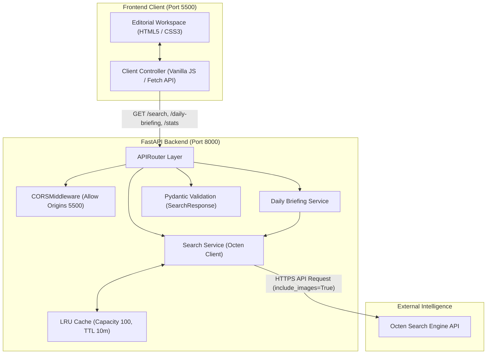

# ResearchMate — AI Research Assistant

ResearchMate is a high-performance, editorial-grade AI research assistant and intelligence platform. It bridges real-time web retrieval with a fast, cached FastAPI backend and a clean, responsive vanilla JavaScript interface—providing researchers, developers, and analysts with structured, verified sources, article thumbnails, and curated daily intelligence.

---

## Table of Contents

- [Problem Statement & Motivation](#problem-statement--motivation)
- [Key Features](#key-features)
- [System Architecture](#system-architecture)
- [Technology Stack](#technology-stack)
- [Project Directory Structure](#project-directory-structure)
- [Local Setup & Installation](#local-setup--installation)
- [Environment Configuration](#environment-configuration)
- [Running the Application](#running-the-application)
- [API Reference](#api-reference)
- [Testing](#testing)
- [Known Limitations & Future Roadmap](#known-limitations--future-roadmap)
- [License](#license)

---

## Problem Statement & Motivation

Modern web search engines are frequently burdened with sponsored placements, SEO bloat, and ad-heavy page designs that disrupt focused research. Researchers, engineers, and students need a distraction-free research interface that quickly retrieves verified primary sources, provides readable summaries, surfaces publisher metadata, and delivers daily news across core technology domains—without the overhead of heavy frontend frameworks or slow backend latencies.

**ResearchMate** was built to solve this by combining:
1. **Low-Latency Retrieval**: Direct integration with the Octen SDK for targeted web search and image extraction.
2. **In-Memory Caching**: An LRU cache with time-to-live (TTL) expiration to eliminate redundant API calls and optimize rate limits.
3. **Editorial Design System**: A responsive, readable layout inspired by news publications and intelligence feeds.

---

## Key Features

- **AI-Powered Web Search**: Queries the web via the Octen SDK with configurable result counts (`3`, `5`, or `10` sources).
- **Daily Intelligence Briefing**: Automatically aggregates and organizes breaking updates across four specialized channels:
  - *AI & Research*
  - *Global Tech*
  - *Developer News*
  - *Jobs & Internships*
- **Real Article Thumbnails & Favicons**: Retrieves genuine publisher imagery and website favicons with native lazy-loading, strict URL sanitization, and graceful category-based fallbacks.
- **Thread-Safe LRU Cache with TTL**:
  - In-memory doubly linked list + hash map supporting thread-safe operations via locks.
  - Configurable capacity (100 entries) and 10-minute expiration TTL.
  - Comprehensive telemetry tracking hits, misses, evictions, and cache hit rates.
- **Resilient Error & Rate-Limit Handling**:
  - Automatically catches and maps `OctenRateLimitError` to HTTP 503 Service Unavailable with friendly client guidance.
  - Input validation enforcing query length and count constraints through Pydantic schemas.
- **Responsive Editorial Dashboard**:
  - Desktop (3-column grid), tablet (2-column grid), and mobile (1-column grid).
  - Shimmering skeleton loaders during network latency.
  - Zero heavy frontend dependencies (pure HTML5, CSS3, and vanilla ES6+).

---

## System Architecture



---

## Technology Stack

### Backend
- **Language**: Python 3.10+ (tested on Python 3.14)
- **API Framework**: [FastAPI](https://fastapi.tiangolo.com/) (ASGI, OpenAPI documentation)
- **Web Server**: [Uvicorn](https://www.uvicorn.org/)
- **Data Validation**: [Pydantic v2](https://docs.pydantic.dev/)
- **Intelligence Provider**: [Octen SDK](https://octen.ai/)
- **Testing**: [pytest](https://docs.pytest.org/), [httpx](https://www.python-httpx.org/) (via FastAPI `TestClient`)

### Frontend
- **Markup**: Semantic HTML5 (accessible ARIA regions and labels)
- **Styling**: Modern vanilla CSS3 (CSS Variables, Flexbox, CSS Grid, media queries)
- **Logic**: Vanilla ECMAScript 6+ (Fetch API, asynchronous controllers, DOM manipulation)

---

## Project Directory Structure

```text
research-assistant/
│
├── backend/
│   ├── api/
│   │   ├── routes/
│   │   │   ├── __init__.py
│   │   │   ├── briefing.py         # GET /daily-briefing router
│   │   │   ├── search.py           # GET /search router with Pydantic validation
│   │   │   └── stats.py            # GET /stats telemetry router
│   │   └── __init__.py
│   ├── cache/
│   │   ├── __init__.py
│   │   ├── lru_cache.py            # Thread-safe LRU Cache with TTL & metrics
│   │   ├── test_thread_safety.py   # Cache concurrency test
│   │   └── test_ttl.py             # Cache expiration test
│   ├── core/
│   │   ├── __init__.py
│   │   └── config.py               # Environment configuration & key loader
│   ├── schemas/
│   │   ├── __init__.py
│   │   └── search.py               # Pydantic models (SearchResult, SearchResponse)
│   ├── services/
│   │   ├── __init__.py
│   │   ├── news_service.py         # Curated daily channels controller
│   │   └── search_service.py       # Octen integration, cache coordination & image extractor
│   ├── logging_config.py           # Application logging configuration
│   └── main.py                     # FastAPI application factory & CORS setup
│
├── frontend/
│   ├── app.js                      # Client API controllers, card rendering & skeletons
│   ├── index.html                  # Accessible editorial workspace layout
│   └── style.css                   # Responsive editorial design system
│
├── tests/
│   └── test_search.py              # Pytest test suite for validation, caching & rate limits
│
├── .env.example                    # Template for required environment variables
├── .gitignore                      # Git exclusion rules (.env, .venv, caches)
├── requirements.txt                # Production and development dependencies
├── test_news.py                    # Standalone verification script for news retrieval
├── test_octen.py                   # Standalone verification script for Octen SDK
└── README.md                       # Project documentation
```

---

## Local Setup & Installation

### Prerequisites
- Python 3.10 or higher
- PowerShell (Windows) or Bash (macOS/Linux)
- An active [Octen API Key](https://octen.ai)

### 1. Clone the Repository
```powershell
git clone https://github.com/sai-coder1/Octen.git
cd Octen
```

### 2. Create and Activate a Virtual Environment
On **Windows PowerShell**:
```powershell
python -m venv .venv
.\.venv\Scripts\Activate.ps1
```

*(On macOS/Linux)*:
```bash
python3 -m venv .venv
source .venv/bin/activate
```

### 3. Install Dependencies
```powershell
pip install -r requirements.txt
```

---

## Environment Configuration

Create a local `.env` file based on `.env.example`:

**Windows PowerShell**:
```powershell
Copy-Item .env.example .env
```

*(On macOS/Linux)*:
```bash
cp .env.example .env
```

Open `.env` in your editor and configure your credentials:
```env
# Octen API Key (Required for AI web search and daily briefings)
OCTEN_API_KEY=your_actual_octen_api_key_here
```

> [!WARNING]
> Never commit your `.env` file or disclose API keys. The `.gitignore` file is configured to exclude all `.env` files.

---

## Running the Application

### 1. Start the FastAPI Backend
From the root directory with the virtual environment activated:
```powershell
python -m uvicorn backend.main:app --reload --port 8000
```
The backend will be accessible at:
- API Base URL: `http://127.0.0.1:8000`
- Interactive OpenAPI Docs: `http://127.0.0.1:8000/docs`

### 2. Start the Frontend
The backend CORS configuration permits requests originating from port `5500`. Start a local web server serving the `frontend` folder:

**Option A — Using Python built-in server (Port 5500)**:
```powershell
python -m http.server 5500 --directory frontend
```

**Option B — Using VS Code Live Server**:
Open the `frontend/index.html` file in VS Code and click **"Go Live"** (default port `5500`).

Navigate to `http://127.0.0.1:5500` in your browser.

---

## API Reference

### 1. Search Web
Retrieves search results matching a research query with optional article imagery.

- **Endpoint**: `GET /search`
- **Query Parameters**:
  - `q` (*string, required*): Search query (minimum 1 character).
  - `count` (*integer, optional*): Number of results to return (range: 1 to 10, default: 3).

**Example Request**:
```http
GET /search?q=quantum+computing&count=3 HTTP/1.1
Host: 127.0.0.1:8000
```

**Example Response (200 OK)**:
```json
{
  "query": "quantum computing",
  "count": 3,
  "results": [
    {
      "title": "Quantum Computing - IBM Research",
      "url": "https://research.ibm.com/quantum",
      "highlight": "IBM quantum processors and research updates...",
      "favicon": "https://research.ibm.com/favicon.ico",
      "image_url": "https://research.ibm.com/images/hero.jpg"
    }
  ]
}
```

**Status Codes**:
- `200 OK`: Successful retrieval.
- `400 Bad Request`: Invalid search parameters.
- `422 Unprocessable Entity`: Validation failure (empty query or out-of-bounds count).
- `503 Service Unavailable`: Upstream Octen rate limit encountered.

---

### 2. Daily Briefing
Fetches curated breaking articles across core technology and engineering channels.

- **Endpoint**: `GET /daily-briefing`
- **Query Parameters**: None.

**Example Response (200 OK)**:
```json
{
  "categories": {
    "AI & Research": [
      {
        "title": "Latest Breakthroughs in Large Language Models",
        "url": "https://example.com/article",
        "highlight": "Researchers have demonstrated new inference scaling laws...",
        "favicon": "https://example.com/favicon.ico",
        "image_url": "https://example.com/cover.webp"
      }
    ],
    "Global Tech": [],
    "Developer News": [],
    "Jobs & Internships": []
  },
  "total_articles": 12
}
```

---

### 3. Cache & System Telemetry
Exposes operational metrics for backend cache performance and external API consumption.

- **Endpoint**: `GET /stats`
- **Query Parameters**: None.

**Example Response (200 OK)**:
```json
{
  "cache": {
    "hits": 14,
    "misses": 5,
    "evictions": 0,
    "hit_rate": 73.68
  },
  "api_attempts": 5
}
```

---

## Testing

The project includes unit and integration tests covering parameter validation, cache behavior, and rate limit responses using `pytest` and FastAPI's `TestClient`.

To run the complete test suite:
```powershell
python -m pytest
```

To run tests with detailed output:
```powershell
python -m pytest -v
```

To run individual cache verification scripts:
```powershell
python -m backend.cache.test_ttl
python -m backend.cache.test_thread_safety
```

---

## Known Limitations & Future Roadmap

### Current Limitations
- **In-Memory Cache**: The LRU cache resides in process memory; cache state resets when the Uvicorn process restarts.
- **Upstream Thumbnail Availability**: Article thumbnail coverage relies on whether upstream web publishers provide OpenGraph / cover image tags in the Octen index (handled smoothly via fallback placeholders).
- **CORS Scope**: CORS is strictly restricted to development origins (`http://127.0.0.1:5500` and `http://localhost:5500`). Production deployments require setting environment-specific allowed origins.

### Future Roadmap
- [ ] **Distributed Cache**: Introduce Redis backing for multi-worker production deployments.
- [ ] **Saved Research Collections**: Local browser storage or database persistence for bookmarked articles.
- [ ] **Export Capabilities**: Export search synthesis and citations to Markdown and BibTeX formats.
- [ ] **Custom Topic Subscriptions**: Allow users to configure bespoke categories in their daily intelligence briefing.

---

## License

This project is open-source under the MIT License.
